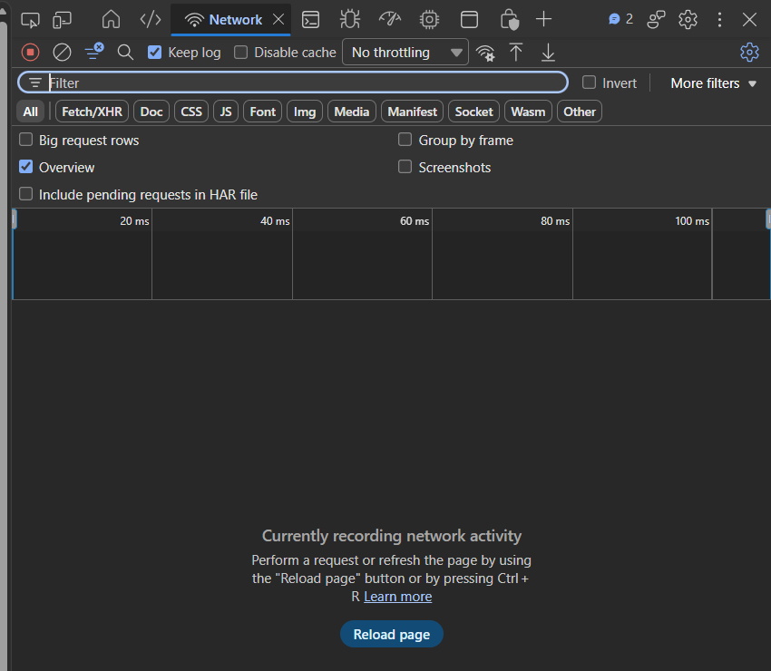
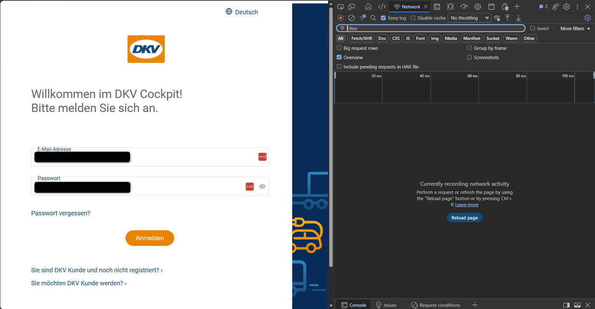
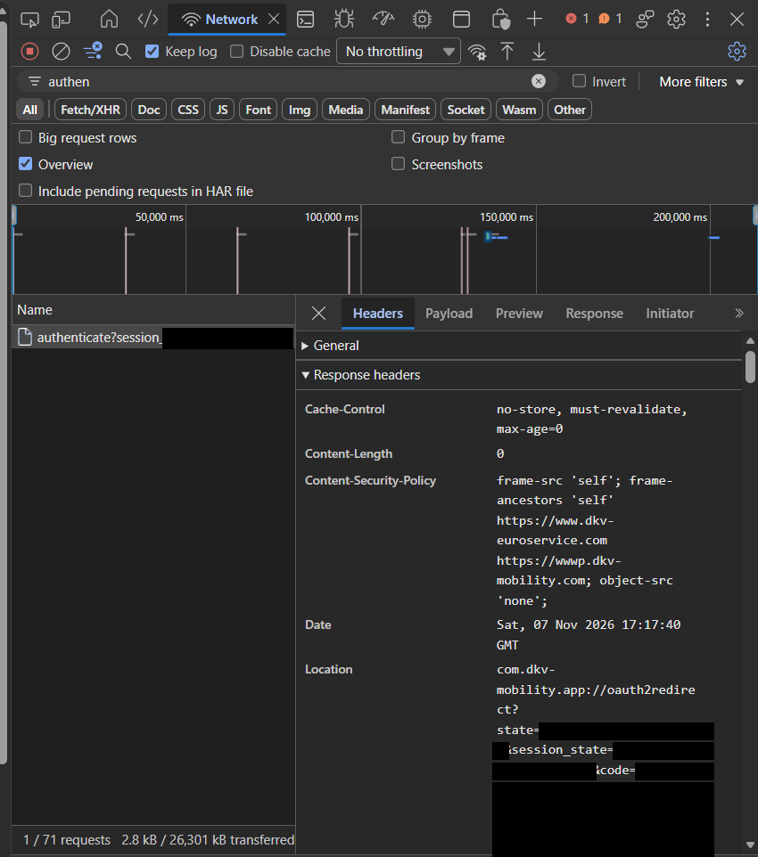

# DKV@Home für Home Assistant

[](https://github.com/wirkaufenfair/DKV-At-Home-Home-Assistant/actions/workflows/ci.yml)
[](https://github.com/wirkaufenfair/DKV-At-Home-Home-Assistant/actions/workflows/contract.yml)

Custom Integration für Home Assistant, um eine **DKV@Home-Wallbox**
einzubinden und einen Ladevorgang per Switch zu starten.

## Funktionen

- Integration als Home-Assistant-Custom-Component (`dkv_at_home`)
- Anmeldung über den Login von DKV (OAuth mit PKCE), langlebiger Token
- Entität: ein `switch` zum Starten und Stoppen des Ladevorgangs
- Zwei Sensoren: Verbrauch und Erstattung, wie DKV sie führt
- Blaupause für eine Automation, die die Wallbox beim Anschließen freischaltet
- Diagnose-Download für Fehlerberichte (ohne Tokens und Kennungen)
- Statusabfrage via Coordinator (Polling alle 30 Sekunden)
- Automatische Token-Aktualisierung (Refresh-Token)

## Aktueller Umfang

- `switch.turn_on`: startet einen neuen Ladevorgang
- `switch.turn_off`: beendet die aktive Session (ab v1.0.29). Der Aufruf
  nutzt den Stopp-Endpunkt der DKV-Web-App und wurde mit einer echten
  Session an einer KEBA P30 verifiziert. Schlägt der Stopp fehl, bitte
  weiterhin die DKV-App oder evcc verwenden und ein Issue mit Debug-Log
  eröffnen.

## Installation

### Option A: Über HACS (empfohlen)

1. HACS öffnen → **Integrations**
2. Menü (oben rechts) → **Custom repositories**
3. Repository-URL eintragen und Kategorie **Integration** wählen
4. `DKV@Home` installieren
5. Home Assistant neu starten

### Option B: Manuell

1. Repository herunterladen
2. Ordner `custom_components/dkv_at_home` nach
  `<config>/custom_components/dkv_at_home` kopieren
3. Home Assistant neu starten

## Einrichtung in Home Assistant

Die Anmeldung läuft wie in der DKV-App. Nach dem Login springt DKV auf eine
App-Adresse (`com.dkv-mobility.app://…`) zurück, die ein Browser nicht öffnen
kann. Diese Adresse enthält den Anmeldecode, den die Integration braucht, und
muss deshalb aus den Entwicklertools des Browsers kopiert werden.

**Was Sie brauchen:** einen Computer mit **Chrome, Firefox oder Edge**. Am
iPhone/iPad und in Safari geht das nicht oder nur sehr umständlich.

### Schritt für Schritt

1. In Home Assistant **Einstellungen → Geräte & Dienste → Integration
   hinzufügen → DKV@Home** wählen. Der Dialog zeigt einen Anmeldelink und ein
   Eingabefeld.

2. Den **Anmeldelink** aus dem Dialog öffnen. Es erscheint die
   DKV-Anmeldeseite. **Noch nicht anmelden.**

3. In diesem Tab die Entwicklertools mit `F12` öffnen, den Tab **Netzwerk**
   (englisch **Network**) wählen und das Häkchen bei **Protokoll
   beibehalten** setzen (englisch **Preserve log**, in manchen Browsern
   **Keep log**). Die Tools müssen offen sein, **bevor** Sie sich anmelden,
   sonst wird die Weiterleitung nicht aufgezeichnet.

   

4. Jetzt bei DKV anmelden.

   

5. Nach dem Login passiert im Browser scheinbar nichts, oder es erscheint eine
   leere Seite bzw. Fehlermeldung. Das ist normal, denn DKV leitet auf die
   Adresse der DKV-App weiter, die ein Browser nicht öffnen kann. Fragt der
   Browser, ob die DKV-App geöffnet werden soll, mit **Abbrechen**
   antworten. Den Tab mit den Entwicklertools **nicht schließen**.

6. Im Netzwerk-Tab ins Filterfeld `authen` eingeben. Es bleibt ein Eintrag
   **`authenticate?session_code=…`** übrig (Methode `POST`, Status
   `302 Found`; das ist die Anfrage, die beim Klick auf „Anmelden“ gesendet
   wird, nicht der Eintrag `auth?…` davor). Diesen Eintrag anklicken, im
   Reiter **Headers** den Bereich **Response headers** (Antwortheader)
   **aufklappen** und den Wert von `Location` kopieren. Er beginnt mit
   `com.dkv-mobility.app://oauth2redirect?code=…`.

   

   (Im Bild sind `state`, `session_state` und `code` geschwärzt. In Ihrem
   Browser stehen dort lange Zeichenfolgen, die komplett kopiert werden
   müssen.)

7. Die **ganze** Adresse in das Feld „Weiterleitungs-URL“ des
   Home-Assistant-Dialogs einfügen und bestätigen. Der Code gilt nur kurz, deshalb am besten sofort.

Funktioniert es nicht („Code abgelaufen“ o. Ä.), erzeugt die Integration einen
neuen Anmeldelink. Dann den Vorgang mit **dem neuen Link aus dem Dialog**
wiederholen. Ein alter Link oder ein anderer Tab führt zum Fehler.

> Statt der Adresse akzeptiert das Feld auch den reinen Anmeldecode oder einen
> vorhandenen Refresh-Token (beginnt mit `eyJ`).

## Automatisches Freischalten (Blaupause)

Damit die Wallbox von selbst freigeschaltet wird, sobald ein Fahrzeug
angeschlossen ist, gibt es eine **Blaupause** für eine Automation. Die
Entscheidung, *wann* gestartet wird, gehört in eine Automation, nicht in die
Integration. Die Integration liefert den Schalter, die Blaupause nutzt ihn.

[](https://my.home-assistant.io/redirect/blueprint_import/?blueprint_url=https%3A%2F%2Fgithub.com%2Fwirkaufenfair%2FDKV-At-Home-Home-Assistant%2Fblob%2Fmain%2Fblueprints%2Fautomation%2Fdkv_at_home%2Fauto_unlock.yaml)

Oder von Hand: **Einstellungen → Automatisierungen & Szenen → Blaupausen →
Blaupause importieren** und diese Adresse einfügen:

```text
https://github.com/wirkaufenfair/DKV-At-Home-Home-Assistant/blob/main/blueprints/automation/dkv_at_home/auto_unlock.yaml
```

Danach eine Automation aus der Blaupause anlegen. Die Eingaben:

| Eingabe | Bedeutung |
| --- | --- |
| Sensor „Fahrzeug angeschlossen“ | ein `binary_sensor`, der „an“ meldet, solange ein Auto angesteckt ist (zum Beispiel von evcc) |
| DKV-Schalter | der Schalter „Ladevorgang“ dieser Integration |
| Anzahl Versuche | wie oft der Start versucht wird (Voreinstellung 10) |
| Pause zwischen den Versuchen | Wartezeit in Sekunden (Voreinstellung 120) |
| Fahrzeugerkennung: Sensor mit dem Fahrzeugnamen (optional) | zum Beispiel ein Sensor aus evcc, der das erkannte Fahrzeug meldet (Voreinstellung leer, also aus) |
| Fahrzeugerkennung: Name des Firmenfahrzeugs (optional) | der Name, den dieser Sensor für das Firmenfahrzeug meldet |
| Fahrzeugerkennung: Wartezeit | wie lange auf die Erkennung gewartet wird, in Sekunden (Voreinstellung 60) |
| Wartezeit vor dem ersten Versuch | optional: Zeit in Sekunden, in der man noch eine andere Karte (zum Beispiel die Partnerkarte) vorhalten kann; 0 startet sofort (Voreinstellung 0) |
| Wartezeit auf die Bestätigung | wie lange nach dem Einschalten auf „an“ gewartet wird, in Sekunden (Voreinstellung 30) |
| Aktionen, wenn es nicht klappt | optional, zum Beispiel eine Meldung aufs Handy |

So verhält sie sich:

- Wechselt der Sensor von „aus“ auf „an“, wird der Schalter eingeschaltet.
  Läuft schon eine Session, passiert nichts, es startet nie eine zweite. Ein
  Neustart von Home Assistant oder ein kurz „nicht verfügbarer“ Sensor lösen
  nichts aus.
- DKV bestätigt den Start nur, solange die Wallbox laden darf (siehe
  „Voraussetzung: Wallbox muss sofort laden dürfen“). Deshalb wird es mit
  Pause wiederholt, bis die Wallbox bestätigt oder die Versuche aufgebraucht
  sind. Dann laufen Ihre „Aktionen, wenn es nicht klappt“.
- Geht der Sensor auf „aus“, enden die Versuche. Es gibt nie zwei Läufe
  gleichzeitig.

### Meldung, wenn es nicht klappt

Die Eingabe „Aktionen, wenn es nicht klappt“ nimmt beliebige Aktionen. Sie
laufen erst, wenn alle Versuche aufgebraucht sind und die Wallbox nicht
freigeschaltet ist. Bei den Voreinstellungen (10 Versuche, 2 Minuten Pause)
dauert das rund 20 bis 25 Minuten nach dem Anschließen. Ein Beispiel im
YAML-Modus der Automation, das einen Hilfsschalter einschaltet und eine
Meldung aufs Handy schickt:

```yaml
use_blueprint:
  path: dkv_at_home/auto_unlock.yaml
  input:
    vehicle_connected: binary_sensor.evcc_angeschlossen
    dkv_switch: switch.dkv_home_wallbox_ladevorgang
    on_failure:
      - action: input_boolean.turn_on
        target:
          entity_id: input_boolean.dkv_freischaltung_fehler
      - action: notify.mobile_app_mein_handy
        data:
          title: DKV-Freischalten fehlgeschlagen
          message: Wallbox nicht freigeschaltet. Bitte in der DKV-App freischalten.
          data:
            tag: dkv_unlock_failed
```

Die Entity-IDs und der Name des Meldedienstes sind Beispiele und müssen
angepasst werden. Mit dem festen `tag` ersetzt eine neue Meldung die alte, und
eine eigene Automation kann sie beim nächsten Anschließen mit der Aktion
`clear_notification` wieder löschen.

### Fahrzeugerkennung mit evcc (optional)

Erkennt evcc das angeschlossene Fahrzeug, kann die Blaupause nur das
Firmenfahrzeug freischalten und alle anderen Autos unberührt lassen. Dafür
in der Blaupause den Sensor wählen, der den Fahrzeugnamen meldet, und
den Namen des Firmenfahrzeugs eintragen (Groß- und Kleinschreibung spielt keine
Rolle). Das ist **optional und standardmäßig aus**.

- evcc erkennt das Fahrzeug erst einige Sekunden nach dem Anschließen. Die
  Blaupause wartet deshalb bis zur eingestellten **Wartezeit** auf den Namen.
- Kommt der Name nicht oder ein anderer, passiert nichts. Ein privates
  Fahrzeug schaltet man dann mit der Partnerkarte oder in der DKV-App frei.
- Die Entity-ID des Sensors hängt von der evcc-Anbindung ab und muss selbst
  gewählt werden.

### Partnerkarte für private Fahrzeuge

Das DKV-Backend verlangt für jede Ladung eine Freigabe, per RFID-Karte oder
App. Mit der Partnerkarte lässt sich ein privates Fahrzeug laden, dessen Strom
nicht erstattet wird. Das ist **optional und standardmäßig aus**. Wer die
Partnerkarte nutzt, sorgt so dafür, dass die Blaupause nicht schneller ist als
die Karte:

- Die **Wartezeit vor dem ersten Versuch** (zum Beispiel 60 Sekunden) gibt Zeit,
  die Partnerkarte vorzuhalten. Die Blaupause schaltet nur ein, wenn noch
  keine Session läuft. Wird in der Wartezeit mit der Partnerkarte freigegeben,
  startet sie nichts, die Wartezeit endet sofort.
- Ohne Wartezeit (0) startet sie gleich beim Anschließen mit der Karte des
  Kontos.

### Wichtig bei gemischter Nutzung: nur das Firmenfahrzeug freischalten

DKV@Home rechnet beim Firmenwagen jede geladene kWh ab und erstattet sie.
Die Freischaltung läuft über die Karte des Kontos. Laden an derselben Wallbox
auch **private** Fahrzeuge (zum Beispiel das des Partners), darf ein privates
Fahrzeug nicht über diese Karte freigeschaltet werden, sonst würde sein Strom
als Firmenladung abgerechnet.

In diesem Fall muss der Sensor der Blaupause **nur dann „an“ melden, wenn das
Firmenfahrzeug angeschlossen ist**, nicht schon bei jedem Auto. Erkennt evcc
das Fahrzeug, legt man dafür in Home Assistant einen Vorlagen-Helfer (Binärer
Sensor) an, der „angeschlossen“ und „Fahrzeug ist das Firmenfahrzeug“
verknüpft, zum Beispiel:

```jinja
{{ is_state('binary_sensor.evcc_angeschlossen', 'on')
   and is_state('sensor.evcc_fahrzeug', 'Firmenwagen') }}
```

Die Entity-IDs sind Beispiele und müssen angepasst werden. Private Fahrzeuge
schaltet man weiterhin mit der Partnerkarte oder der DKV-App frei. Laden an der
Wallbox nur Firmenfahrzeuge, ist nichts weiter zu beachten.

## Entität & Attribute

Die Integration erstellt einen Switch (`DkvChargingSwitch`):

- **Ein (`on`)**: Es existiert `activeSessionId`
- **Aus (`off`)**: Keine aktive Session

Zusätzliche Attribute:

- `charge_point_status`
- `active_session_id`
- `charge_point_name`
- `remote_start_stop_capable` (Angabe von DKV, nur zur Information)

Dazu kommen zwei Sensoren am selben Gerät. Sie zeigen, was DKV zur Wallbox als
`reimbursement` meldet:

| Sensor | Bedeutung | Einheit |
| --- | --- | --- |
| **Verbrauch laut DKV** | `consumption`, gelesen als Energie | kWh |
| **Erstattung laut DKV** | `sum`, gelesen als Betrag | die Währung, die DKV meldet (zum Beispiel EUR) |

Beides sind Annahmen aus einer echten Installation (18,01 und 5,02 EUR, also
etwa 0,28 € je kWh). DKV sagt nicht, für welchen Zeitraum die Werte gelten.
Deshalb tragen die Sensoren keinen Zeitraum im Namen. Meldet DKV keine Zahl,
zeigt der Sensor „unbekannt“.

## Wie die Integration arbeitet

- Bei Updates wird zuerst das Access-Token per Refresh erneuert
- Danach wird der Charge-Point-Status geladen
- Polling-Intervall: **30 Sekunden**
- Beim Starten wird die Session bei DKV angefordert und anschließend
  auf Bestätigung (`activeSessionId`) gewartet
  - Timeout: **60 Sekunden**
  - Prüfintervall: **5 Sekunden**

## Voraussetzung: Wallbox muss sofort laden dürfen

Die DKV-Freischaltung funktioniert nur, wenn die Wallbox in genau diesem
Moment auch tatsächlich laden kann. Das ist eine Erfahrung aus dem Betrieb
mit einer **KEBA P30** zusammen mit **evcc**, keine offizielle Angabe von DKV
oder KEBA und kann bei anderen Wallboxen abweichen.

- Wird die Wallbox beim Anstecken von evcc blockiert (Ladefreigabe aus,
  z. B. wegen PV-Überschuss-Modus), wird der DKV-Start nicht bestätigt.
- In evcc muss deshalb **„Laden bei Verbindung“** aktiv sein. Die Einstellung
  gibt es sowohl an der Wallbox (Ladepunkt) als auch am Fahrzeug, je nach
  Konfiguration reicht eine von beiden. Erst danach schaltet der Switch
  dieser Integration den Ladevorgang bei DKV frei.
- Mit angeschlossenem Auto und freigegebener Wallbox ist der Test
  aussagekräftig. Ohne Auto läuft der Start in den Timeout.

## Tests

| Was | Wann | Befehl |
| --- | --- | --- |
| API-Client, Einrichtungsdialog, Schalter | bei jedem Push (CI) | `pip install -r requirements-test.txt` und `python -m pytest` |
| Home-Assistant-Tests (`tests/ha`) | bei jedem Push (CI, Linux) | `pip install -r requirements-test-ha.txt` und `python -m pytest` |
| Prüfung der DKV-Login-Server | täglich (CI), bei Fehler öffnet sich ein Issue | `python -m pytest -m contract` |

Die täglichen Prüfungen fragen die öffentlichen DKV-Server, ob sie noch
akzeptieren, was die Integration sendet (Client-ID, Weiterleitung, Scopes,
PKCE). So fällt eine Änderung bei DKV auf, bevor sie die Einrichtung bricht.
Ein Login mit echtem Konto lässt sich nicht automatisch testen, denn DKV schützt
sein Anmeldeformular vor Skripten (HTTP 403). Ob DKV beim Start einer Session
neue Pflichtfelder verlangt, lässt sich ebenfalls nicht automatisch prüfen,
denn dafür müsste ein echter Ladevorgang gestartet werden.
Die Home-Assistant-Tests laufen unter Windows nicht, nur unter Linux/macOS.

## Fehlerbehebung

### Bei der Einrichtung

#### „Safari kann die Seite nicht öffnen, da die Adresse ungültig ist“

Das ist normal. Nach dem Login springt DKV auf die Adresse der DKV-App
(`com.dkv-mobility.app://…`), die ein Browser nicht öffnen kann. Die Adresse
mit dem Code steht trotzdem in den Entwicklertools, siehe Schritt 6 der
Einrichtung. Dafür braucht es einen Computer mit Chrome, Edge oder Firefox. Am
iPhone/iPad und in Safari geht das nicht oder nur sehr umständlich.

#### Im Netzwerk-Tab fehlt der Eintrag `authenticate?…`

Die Entwicklertools müssen **vor** dem Klick auf „Anmelden“ offen sein, mit
gesetztem „Protokoll beibehalten“ (Preserve log / Keep log). Sonst wird die
Weiterleitung nicht aufgezeichnet. Den Vorgang mit dem Anmeldelink aus dem
Dialog wiederholen.

#### „Code abgelaufen oder bereits verwendet“

Der Code gilt nur kurz und nur einmal. Der Dialog hat einen neuen Anmeldelink
erzeugt. Den Vorgang **mit diesem neuen Link** wiederholen und die Adresse
sofort einfügen. Ein alter Link oder ein anderer Browser-Tab führt zu diesem
Fehler.

#### „Der eingefügte Refresh-Token ist ungültig oder abgelaufen“

Ein eingefügter Refresh-Token wurde von DKV abgelehnt (zu alt oder schon von
etwas anderem verwendet). Neu anmelden und die Weiterleitungs-URL einfügen.

#### „Ungültige Eingabe“

Das Feld erwartet die vollständige Weiterleitungs-URL (mit `?code=…`), den
reinen Code oder einen Refresh-Token (beginnt mit `eyJ`). Alles andere wird
abgelehnt.

#### „Unbekannter Fehler“

Es ist etwas Unerwartetes passiert. Die Home-Assistant-Logs prüfen und ein
Issue mit der Diagnose-Datei eröffnen (siehe unten).

#### „Verbindung fehlgeschlagen“

DKV war nicht erreichbar oder hat unerwartet geantwortet. Später erneut
versuchen. Bei Dauerfehlern bitte ein Issue mit der Diagnose-Datei eröffnen
(siehe unten).

### Im Betrieb

#### Die Integration meldet „erneut anmelden“ (Reparatur-Hinweis)

Der Login ist bei DKV abgelaufen oder wurde beendet. In Home Assistant auf den
Hinweis klicken und den Anmelde-Ablauf wiederholen. Ein Refresh-Token darf nur
von **einer** Stelle genutzt werden; wird derselbe Login parallel woanders
verwendet, entwerten sich beide.

#### Der Schalter ist „nicht verfügbar“

Die Statusabfrage bei DKV schlägt fehl (Server nicht erreichbar, Login
ungültig oder DKV hat etwas geändert). Kurze DKV-Ausfälle ändern den Zustand
nicht, erst ein harter Fehler macht den Schalter unavailable.

#### Switch startet nicht / keine Bestätigung

- Prüfen, ob Wallbox online ist
- Prüfen, ob die Wallbox gerade laden darf (siehe „Voraussetzung: Wallbox
  muss sofort laden dürfen“)
- Falls DKV den Start annimmt, aber die Wallbox nicht bestätigt,
  kommt nach Timeout (60 Sekunden) eine entsprechende Fehlermeldung

### Fehler melden

Bitte ein [Issue](https://github.com/wirkaufenfair/DKV-At-Home-Home-Assistant/issues)
eröffnen und die **Diagnose-Datei** anhängen: Einstellungen → Geräte & Dienste
→ DKV@Home → drei Punkte → **Diagnose herunterladen**. Die Datei enthält
Versionen, den Zustand und die Struktur der DKV-Antworten (nur Schlüssel und
Typen), aber keine Tokens, Kontonummern oder Kennungen. Home Assistant
ergänzt die Datei selbst um Systeminformationen (Version, Betriebssystem und
die Liste aller installierten eigenen Integrationen, Block `custom_components`).
Das sind keine Geheimnisse, aber persönliche Angaben. Wer sie nicht teilen
möchte, entfernt diesen Block vor dem Anhängen. Für tiefergehende
Fehler hilft zusätzlich das Debug-Log (Einstellungen → Geräte & Dienste →
DKV@Home → Debug-Protokollierung aktivieren).

## Sicherheitshinweis

Die Integration speichert OAuth-Tokens in den Config-Entry-Daten von
Home Assistant. Behandle Backups und Log-Ausgaben entsprechend sensibel.

## Technische Daten

- Domain: `dkv_at_home`
- Plattform: `switch`
- Plattform: `sensor`
- `iot_class`: `cloud_polling`
- Nutzt `requests` (von Home Assistant mitgebracht, keine eigene Abhängigkeit)

## Haftungsausschluss

Dieses Projekt ist ein inoffizielles Community-Projekt und steht in
keiner direkten Verbindung zur DKV Mobility.
